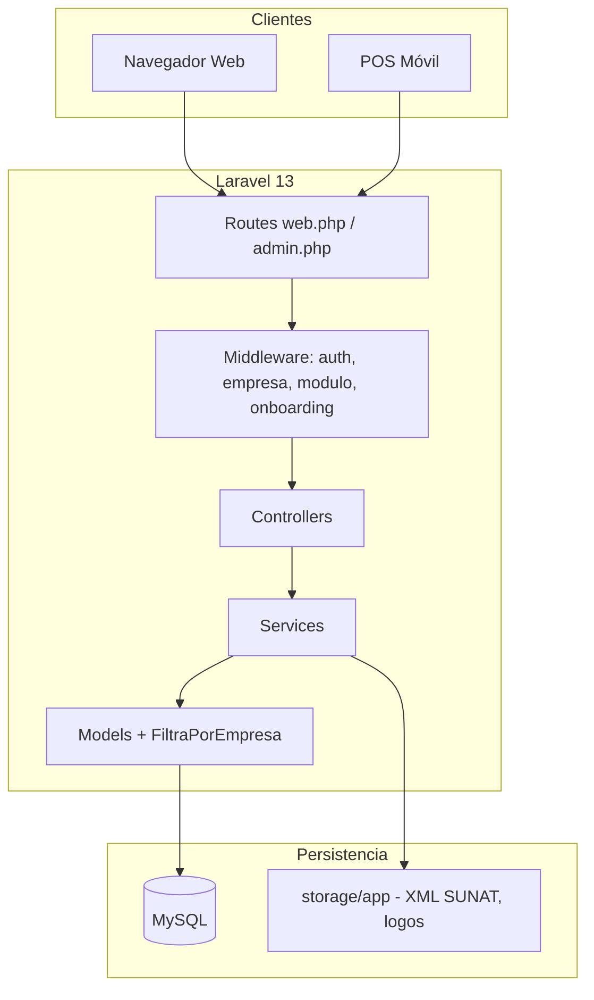

# Arquitectura de software — VentaPOS

## Visión general

VentaPOS es un **SaaS multi-empresa** (multi-tenant por `empresa_id`) para punto de venta, inventario y facturación electrónica en Perú.



## Capas

| Capa | Ubicación | Responsabilidad |
|------|-----------|-----------------|
| Presentación | `resources/views/` | Blade, POS con JS inline |
| HTTP | `app/Http/Controllers/` | Validación request, respuesta view/JSON |
| Middleware | `app/Http/Middleware/` | Auth, tenant, módulos, onboarding |
| Dominio / aplicación | `app/Services/` | Lógica de negocio (ventas, inventario, SUNAT) |
| Persistencia | `app/Models/` | Eloquent, scopes por empresa |
| Configuración | `config/` | Permisos, planes, SUNAT |

## Multi-tenancy

- Cada tabla operativa lleva `empresa_id`.
- Trait `FiltraPorEmpresa` en modelos sensibles.
- Login: código de empresa + usuario (único por empresa, no global).
- Super admin (`rol = super_admin`, `empresa_id = null`) gestiona empresas en `/admin`.

## Módulos y permisos

- Definición: `config/permisos.php`.
- Resolución efectiva: `PermisoService` (plan + `configuracion.modulos_contratados` + rol).
- Middleware `modulo:nombre` en rutas `/app/*`.
- Dueño ve solo módulos contratados; cajero solo POS.

## Flujos críticos

### Venta POS

```
PosController::cobrar → VentaService::registrar → SunatService::emitir (si activo)
→ JSON + ticket_url → ticket con QR embebido (PNG base64)
```

### Compra a proveedor

```
CompraController → CompraService → inventario_movimiento + actualización stock/costo
```

### Anulación de venta

```
VentaController → AnulacionService → reversa stock + SunatService::comunicarAnulacion
```

## Integraciones externas

| Integración | Estado | Componente |
|-------------|--------|------------|
| SUNAT / OSE | Simulación OK; producción vía `OseClient` JSON | `SunatService`, `OseClient` |
| WhatsApp landing | Config `.env` | Landing |
| Import CSV productos | Activo | `ProductoImportService` |

## Estructura de directorios clave

```
app/
  Http/Controllers/     # App, Admin, POS, SUNAT...
  Http/Middleware/      # VerificarModulo, IdentificarEmpresa...
  Models/               # Empresa, Usuario, Comprobante...
  Services/             # VentaService, SunatService, CompraService...
config/
  permisos.php          # Módulos y roles
  planes.php            # Planes comerciales
  sunat.php             # Códigos tipo documento SUNAT
database/migrations/    # Esquema versionado
resources/views/
  app/                  # Panel empresa
  admin/                # Super admin
  layouts/              # app.blade.php, admin.blade.php
routes/
  web.php               # App tenant
  admin.php             # Super admin
tests/
  Unit/                 # Servicios aislados
  Feature/              # Flujos con BD sqlite en memoria
```

## Decisiones arquitectónicas

| Decisión | Motivo |
|----------|--------|
| Blade + JS en POS (no SPA) | Rapidez de desarrollo, impresión ticket, bajo requisito offline |
| Servicios en lugar de actions | Patrón ya establecido; lógica reutilizable desde varios controllers |
| JSON `empresa.configuracion` | Flexibilidad SUNAT, módulos, terminal sin migrar por cada flag |
| SQLite en tests | Velocidad; migraciones MySQL-specific protegidas con `getDriverName()` |
| QR PNG embebido en ticket | Evita carga async y borrosidad de SVG al imprimir |

## Seguridad

- Contraseñas hasheadas (Laravel default).
- CSRF en formularios; POS usa token en fetch JSON.
- Aislamiento por `empresa_id` en queries y autorización en controllers.
- Credenciales SOL en `configuracion` JSON (pendiente: cifrado en reposo).

## Referencias

- [MODULOS_Y_FASES.md](MODULOS_Y_FASES.md)
- [SUNAT.md](SUNAT.md)
- [NOMENCLATURA_BD.md](NOMENCLATURA_BD.md)
