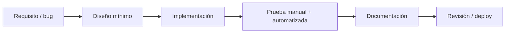

# Metodología de desarrollo

## Enfoque

Desarrollo **iterativo por fases** alineado al modelo de negocio SaaS:

1. Entregar valor operativo (POS usable).
2. Añadir módulos contratables (inventario, compras, SUNAT).
3. Endurecer para producción (tests, despliegue, documentación).

No es Scrum formal; se usan **fases con entregables** documentados en [MODULOS_Y_FASES.md](MODULOS_Y_FASES.md).

## Ciclo de trabajo



### Reglas del ciclo

- **Alcance mínimo:** resolver el problema sin refactorizar áreas no relacionadas.
- **Convenciones existentes:** nombrado en español en BD, servicios en `app/Services`, vistas Blade.
- **Migraciones:** una migración por cambio de esquema; reversible cuando sea posible.
- **Documentación:** obligatoria según [POLITICA_DOCUMENTACION.md](POLITICA_DOCUMENTACION.md).

## Entorno de desarrollo

| Componente | Versión / herramienta |
|------------|----------------------|
| SO local | Windows 10+ con Laragon |
| PHP | 8.3 (`C:\laragon\bin\php\php-8.3.30-Win32-vs16-x64\php.exe`) |
| BD local | MySQL 8 (Laragon) |
| Arranque | `.\iniciar.ps1` → http://127.0.0.1:8000 |
| Dependencias | Composer, npm (assets si aplica) |

**Importante:** no usar PHP del PATH del sistema si es &lt; 8.3; siempre el binario de Laragon.

## Control de versiones

- Repositorio Git en `VentaPOS_build`.
- Commits solo cuando el usuario lo solicite.
- Mensajes en español o inglés técnico, enfocados en el *por qué*.

## Pruebas

| Tipo | Ubicación | Cuándo |
|------|-----------|--------|
| Unit | `tests/Unit/` | Servicios puros (SUNAT XML, OSE client) |
| Feature | `tests/Feature/` | Flujos con BD (`RefreshDatabase`) |
| Manual | Checklist en CASOS_DE_USO | POS, ticket, SUNAT simulación |

Ejecutar:

```powershell
& "C:\laragon\bin\php\php-8.3.30-Win32-vs16-x64\php.exe" artisan test
```

## Convenciones de código

- **Controllers:** delgados; delegar a Services.
- **Validación:** `$request->validate()` en controller o método privado `validar()`.
- **Multi-empresa:** siempre filtrar por `Auth::user()->empresa_id` o scope del modelo.
- **Mensajes UI:** español, claros para usuario de bodega.
- **Permisos nuevos:** actualizar `config/permisos.php` + middleware de ruta.

## Fases del producto (resumen)

| Fase | Objetivo | Criterio de cierre |
|------|----------|-------------------|
| 1 | POS + catálogo + ventas | Cobrar boleta, imprimir ticket |
| 2 | Compras + proveedores + reportes | Registrar compra y actualizar stock |
| 3 | SUNAT simulación + base producción | CPE en ticket con QR, XML guardado |
| 4 | Producción SUNAT real | OSE conectado, firma XML, CDR aceptado |

## Gestión de deuda técnica

Registrar en `docs/README.md` (registro de cambios) o en issues:

- Firma digital XML SUNAT.
- Cifrado de `clave_sol`.
- Cola de reintentos SUNAT.
- Tests E2E del POS en navegador.

## Referencias

- [ARRANQUE_LOCAL.md](ARRANQUE_LOCAL.md)
- [ARQUITECTURA.md](ARQUITECTURA.md)
- [POLITICA_DOCUMENTACION.md](POLITICA_DOCUMENTACION.md)
