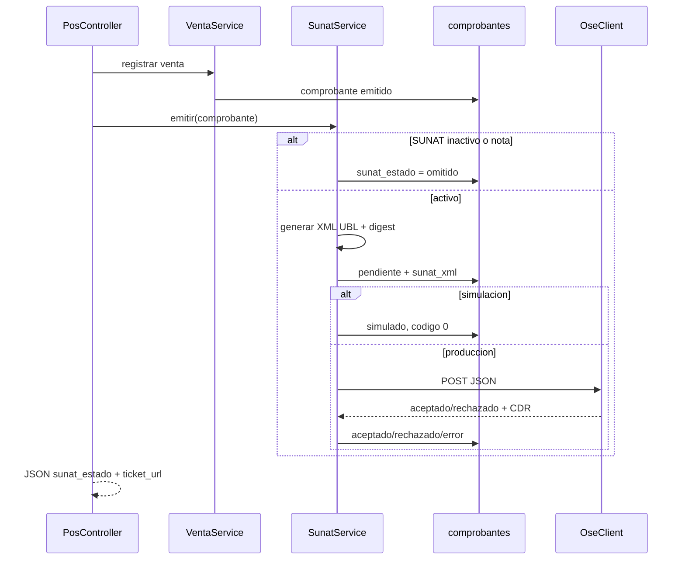

# Módulo SUNAT — Facturación electrónica

Documentación técnica del comprobante electrónico (CPE) en VentaPOS.

## Alcance actual

- **Tipos:** boleta (`03`) y factura (`01`) al cobrar en POS.
- **Modos:** simulación (sin envío real) y producción (vía OSE/PSE configurado).
- **No incluye aún:** firma digital XML, notas de crédito electrónicas completas, guías remisión.

## Configuración

Ruta: `/app/sunat` (dueño + módulo `sunat`).

Almacenamiento en `empresa.configuracion.sunat`:

| Campo | Descripción |
|-------|-------------|
| `activo` | Emite CPE al cobrar |
| `modo` | `simulacion` \| `produccion` |
| `usuario_sol` | Usuario SOL / OSE |
| `clave_sol` | Clave (no se sobrescribe si se deja vacío al guardar) |
| `certificado` | Ruta certificado .pem (reservado para firma) |
| `ose_url` | URL endpoint OSE |

**Precondición:** RUC de 11 dígitos en configuración de empresa.

## Flujo de emisión



## Estados `sunat_estado`

| Estado | Significado |
|--------|-------------|
| `omitido` | SUNAT inactivo o tipo no electrónico |
| `pendiente` | Transitorio antes de respuesta |
| `simulado` | Aceptado en modo prueba |
| `aceptado` | Aceptado por OSE/SUNAT |
| `rechazado` | Rechazado tributario |
| `error` | Error técnico o configuración |

## Campos en `comprobantes`

| Columna | Uso |
|---------|-----|
| `sunat_estado` | Estado del ciclo |
| `sunat_codigo_respuesta` | Código OSE/SUNAT |
| `sunat_mensaje` | Mensaje legible |
| `sunat_hash` | Digest para QR (40 chars base64 de SHA-256) |
| `sunat_xml` | Ruta relativa en `storage/app/sunat/{empresa_id}/` |
| `sunat_cdr` | Ruta CDR de respuesta (producción) |
| `sunat_enviado_en` | Timestamp envío |

## Código QR en ticket

Formato texto (pipe-separated, norma representación impresa Perú):

```
RUC|TIPO|SERIE|NUMERO|IGV|TOTAL|FECHA|TIPO_DOC_CLIENTE|NUM_DOC_CLIENTE|HASH|
```

Implementación:

- `Comprobante::textoQrSunat()` — arma la cadena.
- `QrService::pngDataUri()` — PNG alto contraste, escala 12, ECC nivel M.
- Ticket embebe PNG en **base64** (sin segunda petición HTTP).
- Impresión espera carga de imágenes antes de `window.print()`.

Ruta alternativa: `GET /app/pos/ticket/{id}/qr` → PNG binario.

## API OSE genérica (`OseClient`)

`POST` a `ose_url` con JSON:

```json
{
  "usuario": "...",
  "clave": "...",
  "nombre_archivo": "B001-00000001.xml",
  "archivo_base64": "..."
}
```

Respuesta esperada:

```json
{
  "aceptado": true,
  "codigo": "0",
  "mensaje": "Aceptado por SUNAT",
  "cdr_base64": "..."
}
```

También acepta claves `success`, `codigo_respuesta`, `descripcion`, `cdr`.

## Anulación

Tras `AnulacionService::anular`:

- **Simulación:** append mensaje en `sunat_mensaje`.
- **Producción:** envía XML comunicación de baja simplificado al OSE (si URL configurada).

## UI

| Ubicación | Elemento |
|-----------|----------|
| POS cobrar | Mensaje CPE en línea de éxito |
| Ticket | QR + hash + leyenda electrónica |
| Ventas listado | Columna badge CPE |
| Ventas detalle | Badge, reenviar, descargar XML/CDR |
| Panel SUNAT | Config + tabla comprobantes con error |

## Archivos clave

```
app/Services/SunatService.php
app/Services/OseClient.php
app/Services/QrService.php
app/Http/Controllers/SunatController.php
app/Models/Comprobante.php
config/sunat.php
resources/views/app/pos/ticket.blade.php
tests/Unit/SunatServiceTest.php
tests/Feature/SunatEmitirTest.php
```

## Pruebas

```powershell
& "C:\laragon\bin\php\php-8.3.30-Win32-vs16-x64\php.exe" artisan test --filter=Sunat
```

## Pendientes Fase 3/4

1. Firma XMLDSig con certificado configurado.
2. Validación UBL contra XSD SUNAT.
3. Adaptador por proveedor OSE si el JSON genérico no aplica.
4. Cifrado de `clave_sol` en BD.
5. Job en cola para reintentos automáticos.
